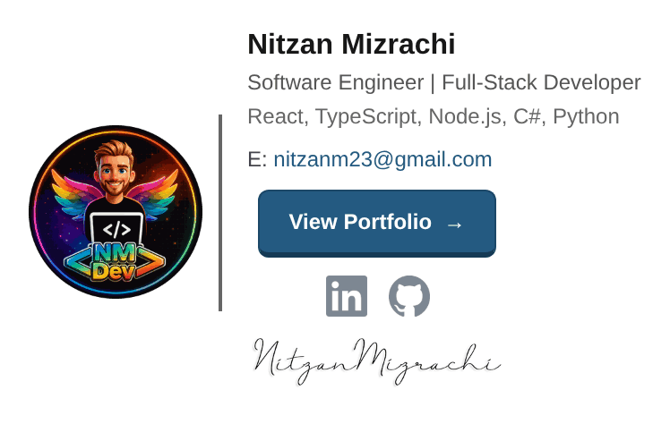

<a id="top"></a>

<div align="center">

  <h1>✉️ Email Signature</h1>

  <h3>My personal HTML email signature, built to render the same in Gmail, Outlook, and Apple Mail.</h3>

  <p>
    <a href="https://nitzanm23.github.io/email-signature/">
      
    </a>
  </p>

  <p>
    
    
  </p>

</div>

<p align="center">
  
</p>

---

## 🎯 Overview

This is the signature I use at the bottom of my emails. Email clients support far less HTML and CSS
than browsers, so it is written the way email HTML has to be: a layout made of tables, styles
inlined on every element, and images with fixed sizes.

GitHub Pages hosts the page and the images. The signature loads its images from those public URLs,
so they still show up after it is pasted into a mail client.

## 🧠 Technical Notes

- **Table layout.** Every table has `role="presentation"`, so screen readers skip the layout and
  read only the content.
- **Inline styles only.** Many clients remove `<style>` blocks, so each element carries its own
  `style` attribute.
- **Outlook support.** `mso-*` properties remove the extra table spacing Outlook adds, and every
  image has `width` and `height` attributes, because Outlook ignores CSS sizes on images.
- **Round logo without CSS.** Outlook for Windows ignores `border-radius`, so the circle is part of
  the PNG itself, with transparent corners.
- **Sharp on high-DPI screens.** Every image is saved at exactly 3× its display size, and the files
  stay small (the logo is 27 KB).
- **Alt text** on every image, for clients that block images by default.

## 🚀 Usage

1. Open the [live page](https://nitzanm23.github.io/email-signature/).
2. Select everything (`Ctrl+A` / `Cmd+A`) and copy it.
3. Paste it into the signature editor of your mail client:

| Client                        | Where to paste                                                          |
| ----------------------------- | ----------------------------------------------------------------------- |
| Gmail                         | Settings → See all settings → General → Signature                       |
| Outlook (web and new Outlook) | Settings → Account → Signatures                                         |
| Outlook (classic, Windows)    | File → Options → Mail → Signatures                                      |
| Apple Mail                    | Settings → Signatures (turn off "Always match my default message font") |

4. Send a test email to yourself, and check it on both desktop and mobile.

## 🔒 Privacy

The public version does not include my phone number. I keep a private copy with it in
`index.local.html`, which `.gitignore` keeps out of the repository. To make your own private copy,
copy `index.html` to a file ending in `.local.html` and add your details there.

## 📁 Project Structure

```text
email-signature/
├── index.html      # The signature (public version)
├── assets/         # Images the signature loads, sized for email
├── originals/      # Full-size source images
└── docs/           # README preview and branding
```

## 🙏 Credits & License

The logo, the handwritten signature, and the images in this repository are my own and are not
licensed for reuse. The LinkedIn and GitHub icons are those companies' trademarks.

## 👤 About Me

<div align="center">

  <h3>NM Dev · Nitzan Mizrachi</h3>

  <p>
    <a href="https://nm-dev.com">
      
    </a>
    <a href="https://www.linkedin.com/in/nitzan-mizrachi/">
      
    </a>
    <a href="mailto:nitzanm23@gmail.com">
      
    </a>
    <a href="https://github.com/nitzanm23">
      
    </a>
  </p>

  <table align="center">
    <tr>
      <td align="center">
        
      </td>
      <td align="center">
        
      </td>
    </tr>
  </table>

  <p><a href="#top">⬆ Back to top</a></p>

</div>
